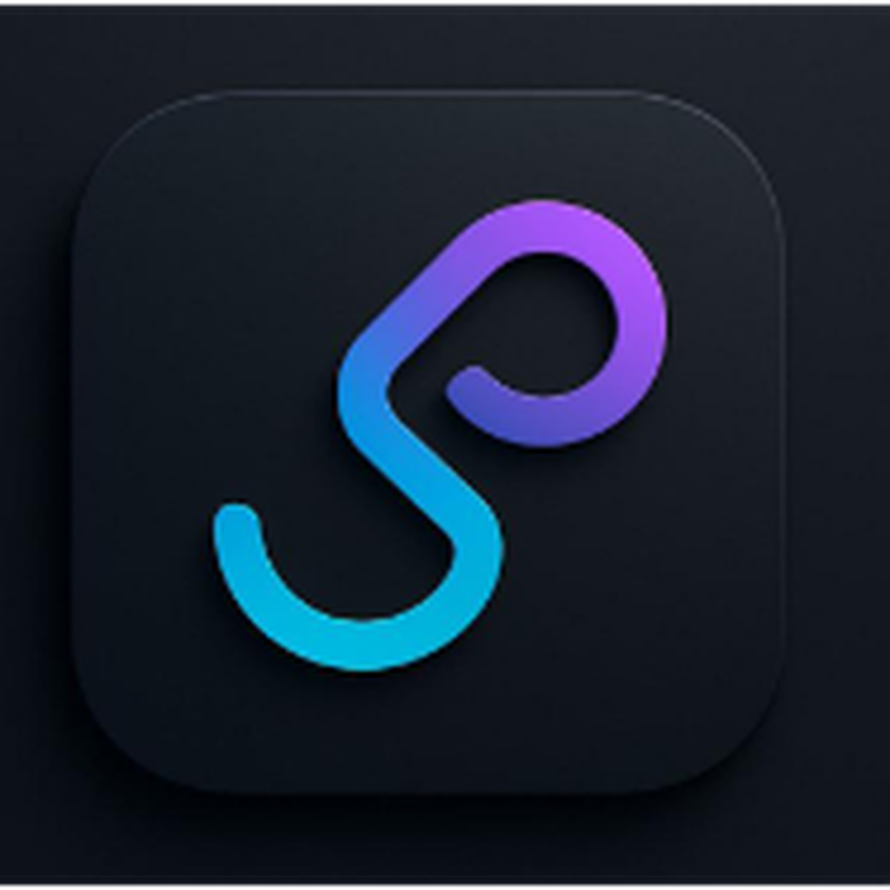
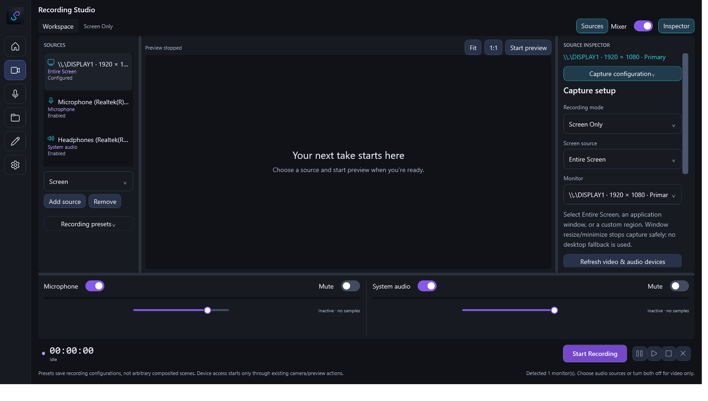
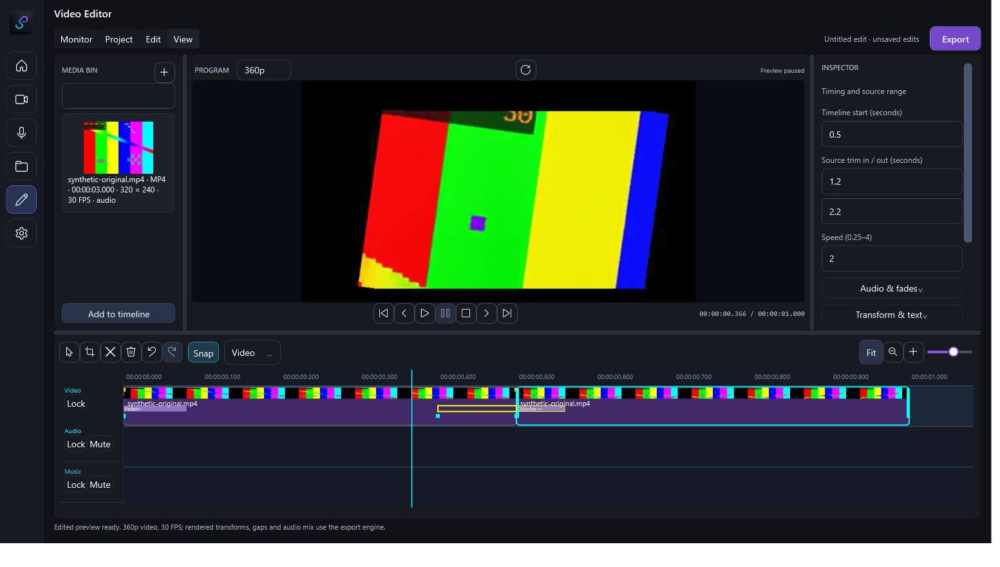
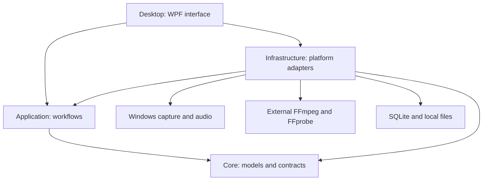

<div align="center">



# CaptureFlow

### Record with clarity. Edit with precision.

Screen, webcam and audio recording. A focused timeline. One Windows workspace.

<p>
  
  
  
  <a href="LICENSE"></a>
  
</p>

**[Product preview](#product-preview) · [Features](#from-capture-to-final-cut) · [Get started](#getting-started) · [Documentation](#documentation)**

[Report an issue](https://github.com/Janith2002/CaptureFlow/issues) · [Contribute](docs/CONTRIBUTING.md)

</div>

---

CaptureFlow brings source selection, recording, timeline editing and media export into a desktop application for demonstrations, walkthroughs and narrated content. Built with C# and WPF, it keeps the preview prominent and detailed controls within reach.

## Product preview

### Recording Studio

**Set the scene. Keep the workspace clear.** A large monitor, collapsible Sources and Inspector panels, and independent microphone/system-audio controls.



### Video Editor

**See the edit take shape.** A rendered preview above the timeline, with clip selection, trimming and Inspector properties close at hand.



<sub>Genuine M69.2 QA screenshots: stopped recording workspace and synthetic editor media. They show the workspace design, not acceptance of physical recording or the later toolbar/export-status repairs.</sub>

## From capture to final cut

### Screen Recording

Choose an entire screen, application window or custom region. Configure resolution, frame rate, quality, countdown and cursor effects; save recording presets for your next session.

### Webcam and Picture-in-Picture

Use **Webcam Only** or combine screen and camera in **Screen + Webcam**. Select the device/format, configure the overlay and use mode-aware preview controls. Device readiness and permissions still apply.

### Microphone and System Audio

Record a microphone, system audio or both through NAudio/WASAPI. Adjust independent levels and mute controls, then choose WAV or MP3 for audio recordings.

### Timeline Editing

Drag and trim clips, split at the playhead and crop the source. Shape the edit with transforms, text, supported transitions and keyframes; mix clip/track audio with gain, mute and fades.

### Media Export

Export **MP4, MP3 or WAV** with retained status, elapsed time and output location. Progress shows a percentage when reliable, otherwise an indeterminate indicator; completion and errors remain visible.

### Project Management

Save and reopen projects, browse the local media library and use best-effort autosave/recovery. Projects reference original media; preview renders and exports are separate files.

[Full feature reference →](docs/FEATURES.md)

## Engineered for Windows

- **Desktop:** C# · .NET 10 · WPF · view models and commands.
- **Capture:** Windows capture APIs · NAudio/WASAPI microphone and loopback audio.
- **Media and storage:** external FFmpeg/FFprobe · SQLite · local project/recovery files.
- **Verification and packaging:** xUnit · Inno Setup scripts for future approved installers.



The editor renders an edited preview for WPF playback; it is not a realtime compositor. [Explore the architecture →](docs/ARCHITECTURE.md)

## Getting started

Build on **Windows 11 x64** with the **.NET 10 SDK**:

```powershell
git clone https://github.com/Janith2002/CaptureFlow.git
cd CaptureFlow
dotnet restore CaptureFlow.slnx
dotnet build CaptureFlow.slnx
dotnet test CaptureFlow.slnx --no-build
dotnet run --project src/CaptureFlow.Desktop/CaptureFlow.Desktop.csproj
```

For media operations, install compatible **FFmpeg and FFprobe** separately. In **Settings → External tools**, select `ffmpeg.exe` and choose **Validate and Save**. Matching `ffprobe.exe` must be beside it; documented workflows require **libx264, AAC and libmp3lame**. Tools are not bundled or automatically downloaded.

[Installation and system requirements →](docs/INSTALLATION.md)

## Development status

**Beta preparation · proposed 0.2.0-beta.1.** A public installer is **not yet approved**. Follow [Releases](https://github.com/Janith2002/CaptureFlow/releases) for future availability.

Previously verified: **893 automated tests passed**, build **0 warnings/errors**. Formal manual QA: **20 PASS / 26 Not Run**. No new test run is claimed by this documentation update.

Physical recording/playback, A/V synchronization, final export acceptance, performance/resource retention and clean-machine deployment remain open. [Known issues and verification boundaries →](docs/KNOWN-ISSUES.md)

## Documentation

- **Learn the workflow:** [User guide](docs/CaptureFlow-Complete-User-Guide.md) · [PDF manual](artifacts/release/docs/CaptureFlow-Complete-User-Guide.pdf)
- **Set up and explore:** [Installation](docs/INSTALLATION.md) · [Architecture](docs/ARCHITECTURE.md) · [Features](docs/FEATURES.md)
- **Find answers:** [Troubleshooting](docs/TROUBLESHOOTING.md) · [Privacy](docs/PRIVACY.md) · [Known issues](docs/KNOWN-ISSUES.md)
- **Take part:** [Contributing](docs/CONTRIBUTING.md) · [MIT License](LICENSE) · [Third-party notices](docs/THIRD-PARTY-NOTICES.md)

## Open source, built together

CaptureFlow's original code and documentation are **[MIT licensed](LICENSE)**. Focused code contributions, documentation improvements and reproducible bug reports are welcome. Third-party components retain their own licenses and notices.

Use [GitHub Issues](https://github.com/Janith2002/CaptureFlow/issues) for non-sensitive reports, preferably with synthetic media. Redact credentials, private paths and device identifiers; never upload personal recordings or projects. Preview can initialize a physical device before recording, so enable it deliberately. [Contribution guide](docs/CONTRIBUTING.md) · [Privacy guidance](docs/PRIVACY.md)

---

<div align="center">


**CaptureFlow**<br>
[User guide](docs/CaptureFlow-Complete-User-Guide.md) · [Contribute](docs/CONTRIBUTING.md) · [Feedback](https://github.com/Janith2002/CaptureFlow/issues)

</div>
