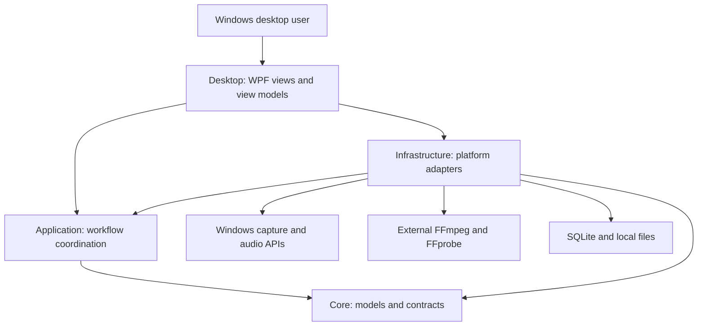

<div align="center">


# CaptureFlow

### Record with clarity. Edit with precision.

A Windows workspace for screen, webcam and audio recording.<br>
Bring your media onto the timeline. Shape the edit. Review the result.

<p>
  
  
  
  
</p>

**[Explore](#a-workspace-for-the-whole-workflow) · [Preview](#inside-captureflow) · [Get started](#getting-started) · [User guide](docs/CaptureFlow-Complete-User-Guide.md) · [Contribute](#build-it-together)**

Open source. Thoughtful Windows design.<br>
<sub>MIT-licensed original code · third-party components retain their own terms.</sub>

</div>

---

## A workspace for the whole workflow

CaptureFlow brings recording, editing and export into one Windows desktop application. It is built for people making demonstrations, walkthroughs and narrated content who want a clear recording workspace and a practical timeline without switching tools at every step.

**Choose a source → shape the timeline → review the preview → export a new file.**

### Inside CaptureFlow

**Recording Studio** — a spacious monitor, collapsible source controls and an accessible audio mixer.


**Video Editor** — rendered preview above a multitrack timeline, with selection and Inspector close at hand.


<sub>Real M69.2 QA captures, reviewed for privacy. Recording is stopped; the editor uses synthetic media. These earlier workspace views do not demonstrate later webcam-toolbar or export-status repairs, physical recording acceptance, or final visual approval.</sub>

## Capture your way

| Video recording | Audio recording |
|---|---|
| **Screen Only** — entire screen, application window or custom region | **Microphone Only** — selected input |
| **Webcam Only** — selected camera | **System Audio Only** — selected output loopback |
| **Screen + Webcam** — screen with picture-in-picture | **Microphone + System Audio** — combined sources |

These modes are implemented. Physical webcam/PiP recording, playback and A/V synchronization still need documented acceptance. Camera-mode selection or preview can initialize a device; enable it only when intended.

## Small details. A complete workflow.

| Workspace | What is implemented |
|---|---|
| **Recording** | Screen/window/region selection, presets, quality/FPS controls, countdown and cursor effects. |
| **Webcam & PiP** | Device/format selection, camera preview and overlay layout; mode-aware main-toolbar preview actions. |
| **Audio** | Microphone and WASAPI loopback, independent levels/mute, WAV and MP3 recording choices. |
| **Timeline** | Clip dragging, edge trims, splitting, cropping, transforms, text, supported transitions and keyframes. |
| **Mixing** | Clip/track gain and mute, fades and silence-analysis operations. |
| **Projects & library** | Project save/load, source references, local library and best-effort recovery/autosave. |
| **Export** | MP4, MP3 and WAV; retained status, reliable percentage or indeterminate progress, elapsed time, output path and completion/error actions. |
| **Usability** | Collapsible panels, layout reset, compact controls, global shortcuts and optional tray behavior. |

Preview is an explicit timeline render played through WPF, not a realtime compositor. Output validation and automated coverage do not replace listening to or viewing the finished file. [Feature details →](docs/FEATURES.md)

## Made for Windows

**C# / .NET 10 / WPF** form the desktop application. **Windows capture APIs** and **NAudio/WASAPI** handle supported source paths. External **FFmpeg/FFprobe** handle media processing. **SQLite** stores library data; **xUnit** supports regression testing. **Inno Setup** scripts prepare future Windows installers.

### System architecture



Projects reference source media. Preview renders and final exports are separate outputs; recovery retains owned intermediates. [Architecture guide →](docs/ARCHITECTURE.md)

## Getting started

### Evaluate the application

**A verified public installer is not available yet.** The historical `0.1.0-preview` setup predates current repairs and is not the current candidate. The proposed next version is **0.2.0-beta.1**, intended as a prerelease.

Follow [GitHub Releases](https://github.com/Janith2002/CaptureFlow/releases) for future approved availability. There is no installer download button here because no current installer is approved.

### Build from source

Clone the source repository, then build on Windows. The proposed beta has no approved public installer yet.

Prerequisites: **Windows 11 x64**, **.NET 10 SDK**, and compatible external **FFmpeg/FFprobe** for media operations. Configure **Settings → External tools → Validate and Save**. Matching `ffprobe.exe` belongs beside `ffmpeg.exe`; documented workflows need libx264, AAC and libmp3lame. Tools are not bundled or automatically downloaded.

```powershell
git clone https://github.com/Janith2002/CaptureFlow.git
cd CaptureFlow
dotnet restore CaptureFlow.slnx
dotnet build CaptureFlow.slnx
dotnet test CaptureFlow.slnx --no-build
dotnet run --project src/CaptureFlow.Desktop/CaptureFlow.Desktop.csproj
```

These commands match the solution/project paths; they were not rerun for this documentation update. Save and close a development instance yourself before rebuilding locked outputs. [Installation and requirements →](docs/INSTALLATION.md)

## Documentation, at your pace

| Start here | Go deeper |
|---|---|
| [Complete user guide](docs/CaptureFlow-Complete-User-Guide.md) | [Architecture](docs/ARCHITECTURE.md) |
| [Download the PDF manual](artifacts/release/docs/CaptureFlow-Complete-User-Guide.pdf) | [Feature reference](docs/FEATURES.md) |
| [Installation](docs/INSTALLATION.md) | [Troubleshooting](docs/TROUBLESHOOTING.md) |
| [Privacy and permissions](docs/PRIVACY.md) | [Known issues](docs/KNOWN-ISSUES.md) |
| [Change log](docs/CHANGELOG.md) | [Third-party notices](docs/THIRD-PARTY-NOTICES.md) |

## Development status

**Beta preparation, with human verification still in progress.** The last verified development run passed **893 automated tests** with **0 build warnings/errors**. Formal manual QA remains **20 PASS / 26 Not Run**; those cases are not implied to pass by this README.

Physical recording/synchronization, complete export playback evidence, lag/resource retention, signing and clean-machine installation remain open. No production-ready installer or universal device compatibility is claimed. [Current limitations →](docs/KNOWN-ISSUES.md)

## Privacy belongs in the workflow

Recordings, projects, diagnostics and recovery data can contain sensitive information. Preview can access physical devices before recording. Choose sources deliberately, obtain consent and prefer synthetic media for bug reproductions.

Use [GitHub Issues](https://github.com/Janith2002/CaptureFlow/issues) for non-sensitive reports. Redact credentials, private paths and device identifiers; do not post personal recordings or projects. No private vulnerability-reporting channel is approved, so avoid public disclosure of sensitive exploit details. [Privacy guide →](docs/PRIVACY.md)

## Build it together

CaptureFlow is open source under the [MIT License](LICENSE). Bug reports, documentation feedback and focused code contributions are welcome. Start with the [contribution guide](docs/CONTRIBUTING.md).

Original CaptureFlow code and documentation use MIT. Third-party licenses and notices remain intact; external tools and embedded font rights are not relicensed. No trademark rights are implied. [License status](docs/SOURCE-CODE-POLICY.md) · [Compatibility review](docs/DEPENDENCY-LICENSE-AUDIT.md)

---

<div align="center">

**CaptureFlow**<br>
Record with clarity. Edit with precision.

[Guide](docs/CaptureFlow-Complete-User-Guide.md) · [Road to beta](docs/KNOWN-ISSUES.md) · [Feedback](https://github.com/Janith2002/CaptureFlow/issues)

</div>
