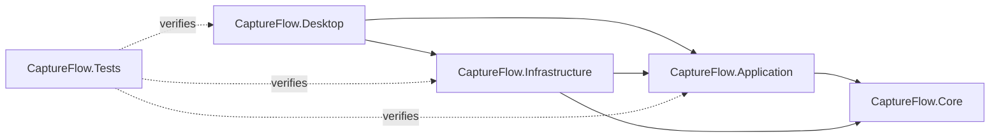

# CaptureFlow architecture

CaptureFlow is a .NET 10 Windows desktop application. The solution separates domain contracts, workflow coordination, platform implementation and WPF presentation.

## Projects and responsibilities

| Project | Responsibility |
|---|---|
| `src/CaptureFlow.Core` | Recording/editing models, validation and interfaces. |
| `src/CaptureFlow.Application` | Workflow coordination against contracts; no WPF dependency. |
| `src/CaptureFlow.Infrastructure` | Windows capture/audio/media processing, external tools, SQLite and filesystem persistence. |
| `src/CaptureFlow.Desktop` | WPF views/view models, commands, startup, workspace state, tray and global shortcuts. |
| `tests/CaptureFlow.Tests` | Deterministic domain/backend/command coverage and selected real-WPF regressions. |
| `tools` | Local QA and icon-check utilities, separate from normal launch. |
| `installer` | Inno Setup and an explicitly authorized candidate build procedure; no current public installer. |

The first four rows reflect actual project references. Production projects target .NET 10; UI/infrastructure use the Windows target framework. Desktop runs WPF on an STA thread.

## Media and persistence

Windows capture/camera and NAudio/WASAPI adapters feed existing recording pipelines. FFmpeg/FFprobe run as external processes. Source readiness and lifetime checks are distinct from command reachability.

The editor snapshots its project for rendering. Update preview creates an edited file; WPF plays/seeks it. It is not a realtime compositor; seeking is codec-dependent. Export validates output before publication and presents retained progress/completion/failure state.

Projects retain edit state and source references, not embedded media. SQLite holds library metadata; JSON stores preferences/recovery records. Media/work/recovery files have separate ownership and lifecycle checks. User originals must be preserved.

## Verification boundaries

The last verified development suite passed 893 tests, including a real-WPF export-progress binding regression. This does not imply physical camera, synchronization, human listening or deployment acceptance. See [known issues](KNOWN-ISSUES.md).

CaptureFlow's original code is open source under MIT; third-party terms remain separate. See [license status](SOURCE-CODE-POLICY.md).
